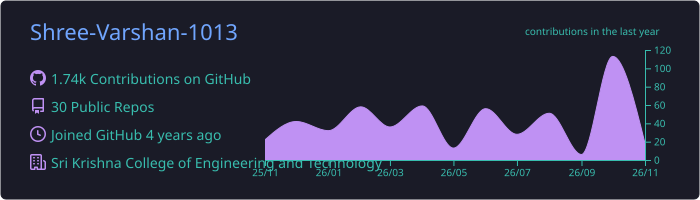
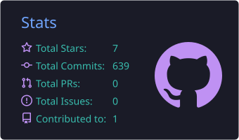
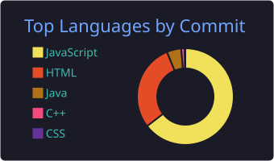

<h1 align="center">Hi 👋, I'm Shree Varshan G</h1>

  

  

---

## 💫 About Me

- 👨‍💻 A passionate **Full-Stack Developer** from India
- 🔭 Exploring new horizons at **SKCET - LABS**!
- 🌱 Delving into the world of **Laravel**, one line of code at a time!
- 💬 Let's chat about the wonders of **React**, **Spring Boot**, and more!
- ⚡ Fun fact: When boredom strikes, it's **'OverThink'** mode activated!

---

<h3 align="center">🛠️ Languages and Tools</h3>

  
    
  

  
  
  
  
  
  

---

<h3 align="center">🐍 Contribution Snake</h3>

  <picture>
    <source media="(prefers-color-scheme: dark)" srcset="https://raw.githubusercontent.com/Shree-Varshan-1013/Shree-Varshan-1013/output/github-snake-dark.svg" />
    <source media="(prefers-color-scheme: light)" srcset="https://raw.githubusercontent.com/Shree-Varshan-1013/Shree-Varshan-1013/output/github-snake.svg" />
    
  </picture>

---

<h3 align="center">📊 GitHub Stats</h3>

  

  

  
  

---

<h3 align="center">📫 Ping Me Here!</h3>

  
  
  

  

